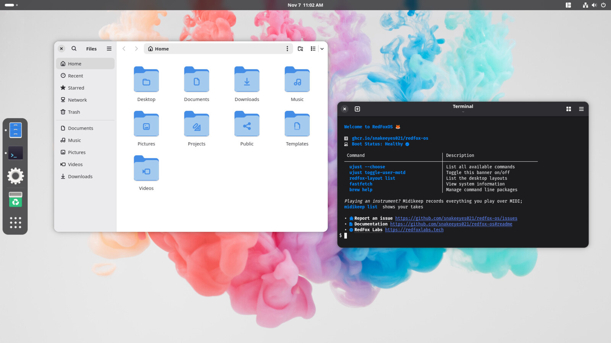
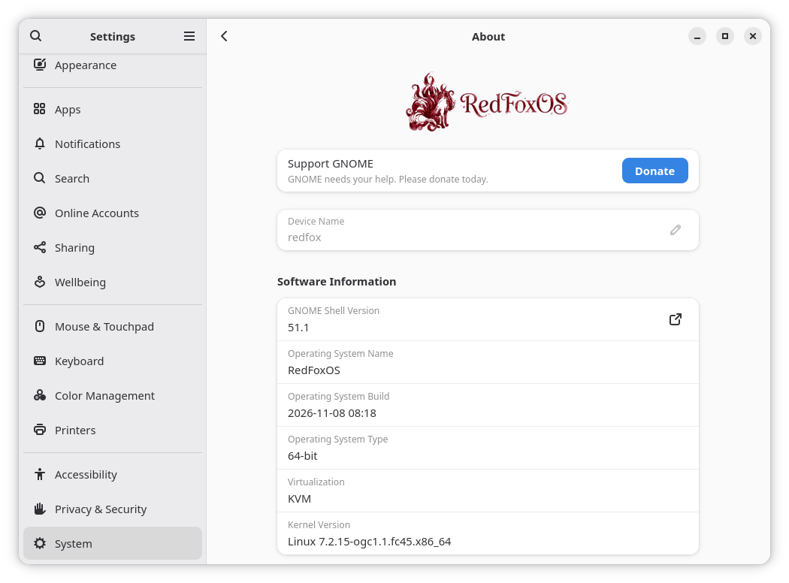

# RedFoxOS

   



*The RedFoxOS desktop with the RedFox layout.*

## Purpose
The purpose of RedFoxOS is to round out the offerings of Bazzite, both with some of the features included in Bluefin DX (and therefore Bazzite DX) as well as a few features, apps, and configs not present in either.

Its primary raison d'être is to provide driver support for Pascal-series NVIDIA cards on a Bluefin/Bazzite DX-style OS. While vanilla Bazzite will support Pascal cards through 2028ish, both Bluefin (vanilla or DX) and Bazzite DX have dropped support; therefore the only way to achieve said developer experience with Pascal cards is to configure it oneself on top of vanilla Bazzite. Enter RedFoxOS.

## Features

### Core Developer Experience
- [x] **Containerization:** Docker (Engine & CLI), Podman (with Compose & TUI), Incus, LXC
- [x] **Virtualization:** Libvirt/QEMU, Cockpit (Machines, Podman, Bridge), System-level GNOME Boxes + Virt-Manager
- [x] **Development:** VS Code (system install), Android Tools, BPF Tools (bpftop, bpftrace), Sysprof, pixi/uv
- [x] **CLI Utilities:** zsh, restic, rclone, ccache
- [x] **Editor:** Zed (ujust recipe installer)
- [ ] **AI Utilities:** Cursor (system), ramalama (system), Ollama (system), OpenClaw (ujust)

### Desktop & Media
- [x] **NVIDIA Pascal Support:** Built on `bazzite-gnome-nvidia` for legacy driver support
- [x] **Curated App Packs:** Creative, Productivity, Dev, and several other curated app bundle installers, all installable via simple ujust recipes
- [ ] **GNOME config:** Several preset desktop environment configs, including a mostly "vanilla" GNOME config, all available via simple ujust recipes
- [ ] **More:** Wallpaper, keyboard shortcuts, shell prompt, etc.



*Settings › System › About on RedFoxOS (in a virtual machine).*

## Installation

> [!CAUTION]
> **GNOME ONLY:** This image is based on GNOME. **Do not rebase** from a KDE-based image (like Kinoite or mainline Bazzite), as this can cause significant desktop environment conflicts. If you are currently on KDE, please install a fresh copy of a GNOME-based Fedora Atomic distro first, then rebase to RedFoxOS.

We have three images available, depending on your hardware:

*   **RedFoxOS (AMD & Intel)** (`redfox-os`): AMD & Intel graphics.
*   **RedFoxOS NVIDIA** (`redfox-os-nvidia`): NVIDIA GTX 16xx, RTX 20xx and newer.
*   **RedFoxOS NVIDIA Legacy** (`redfox-os-nvidia-legacy`): NVIDIA GTX 10xx, 9xx and 750. Older NVIDIA cards run on RedFoxOS (AMD & Intel).

> [!TIP]
> **Not sure which one to pick?**
>
> The [download page](https://redfoxlabs.tech/download/) can tell you. Or run this in a terminal on the computer:
>
> ```bash
> curl -sL https://raw.githubusercontent.com/snakeeyes021/redfox-os/main/extras/identify_gpu.sh | bash
> ```
>
> On Windows, in PowerShell: `irm https://raw.githubusercontent.com/snakeeyes021/redfox-os/main/extras/identify_gpu.ps1 | iex`
>
> Either names the download that works best on your machine, as its card on the download page names it, and gives the page's address. Nothing about the computer is sent anywhere. RedFox Hub's image picker marks the same image "Works best on your machine": both use [`gpu-rules.json`](files/system/usr/share/redfox/gpu-rules.json).

### Rebasing from Bluefin or Bazzite (GNOME)
To switch to RedFoxOS from an existing GNOME-based Universal Blue installation, choose the command that corresponds to your hardware:

**1. Rebase to the signed image**

*   **RedFoxOS (AMD & Intel):**
    ```bash
    rpm-ostree rebase ostree-image-signed:docker://ghcr.io/snakeeyes021/redfox-os:latest
    ```

*   **RedFoxOS NVIDIA:**
    ```bash
    rpm-ostree rebase ostree-image-signed:docker://ghcr.io/snakeeyes021/redfox-os-nvidia:latest
    ```

*   **RedFoxOS NVIDIA Legacy:**
    ```bash
    rpm-ostree rebase ostree-image-signed:docker://ghcr.io/snakeeyes021/redfox-os-nvidia-legacy:latest
    ```

**2. Reboot**
```bash
systemctl reboot
```

> [!NOTE]
> **Fedora Silverblue Users:** Direct rebasing from Fedora Silverblue is not officially supported. Silverblue's default configuration will reject the signed commands above. While we recommend switching from a fresh Bluefin or Bazzite (GNOME) install first, advanced users can perform a direct migration by using a "two-step" method:
>
> 1.  **Rebase to unverified:** Modify the appropriate command above to use `ostree-unverified-registry` (instead of `ostree-image-signed`). This installs the OS but temporarily bypasses the initial verification check.
> 2.  **Reboot:** Restart your system to boot into RedFoxOS.
> 3.  **Rebase to signed:** Once rebooted, run the original signed command listed above. This ensures your system is properly verified for all future updates.

## Rolling Back and Switching Builds

Every update keeps the previous system. To go back to it, pick it in the boot menu, or run:

```bash
ujust rollback-helper            # a menu
ujust rollback-helper rollback   # boot the previous system next time
ujust rollback-helper list       # recent builds of your channel (latest or unstable)
ujust rollback-helper rebase 20261101   # a dated stable build; also: a commit, latest, unstable
```

A dated or commit build doesn't update by itself; `ujust rollback-helper rebase latest` (or `unstable`) follows updates again.

## Verification

These images are signed with [Sigstore](https://www.sigstore.dev/)'s [cosign](https://github.com/sigstore/cosign). You can verify the signature by downloading the `cosign.pub` file from this repo and running:

```bash
cosign verify --key cosign.pub ghcr.io/snakeeyes021/redfox-os
```

## ISO Installation

Live ISOs are on the [download page](https://redfoxlabs.tech/download/), one for each image; it says which one fits your graphics. To install:

1.  Write the ISO to a USB stick of 16 GB or more with [Fedora Media Writer](https://flathub.org/apps/org.fedoraproject.MediaWriter) or [balenaEtcher](https://etcher.balena.io/). Everything on the stick is erased.
2.  Start the computer from the stick. It needs UEFI, not legacy/CSM mode.
3.  Try RedFoxOS in the live session if you like, then choose *Install RedFoxOS*, pick the disk, and create your account.
4.  Restart. With Secure Boot on, a blue screen asks once to enrol Universal Blue's key: *Enroll MOK*, *Continue*, *Yes*, password `universalblue`, *Reboot*.

The installed system follows the stable channel and updates itself from then on. RedFox Hub can switch it to the unstable channel or another image later.

## Secure Boot

RedFoxOS uses Bazzite's kernel, which is signed with Universal Blue's key. With Secure Boot on, the computer needs that key enrolled once: run `ujust enroll-secure-boot-key`, and at the next restart, a blue **MOK management** screen appears:

1. Choose **Enroll MOK**, then **Continue**, then **Yes**.
2. Type the password `universalblue`.
3. Choose **Reboot**.
