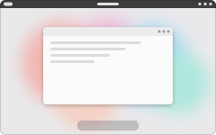
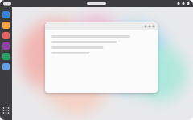
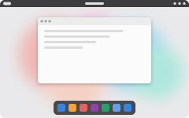
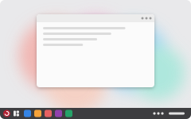
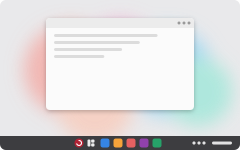
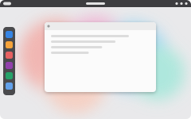

# Layout names

Status: proposal for Matt to pick from. Nothing is renamed yet.

RedFox's six desktop layouts shouldn't carry other systems' names (Windows, macOS, Ubuntu) anywhere a person sees them. Below is a proposed name for each, with a small preview for the layout picker in the future config app. The previews are SVGs drawn by [`assets/layouts/make-previews.py`](../assets/layouts/make-previews.py); rerun it after changing a layout.

The internal ids (`redfox-layout set ubuntu` and so on) stay as they are, so scripts and saved settings keep working. Only the names people read change.

| Preview | Proposed name | What it is | Other names to consider | Internal id |
| --- | --- | --- | --- | --- |
|  | **GNOME** | Just the top bar. The dash appears in the overview. | Minimal, Clean | `gnome` |
|  | **Side Dock** | A full-height dock on the left, always visible. | Sidebar, Rail | `ubuntu` |
|  | **Bottom Dock** | A floating dock along the bottom, window buttons on the left. | Floating Dock, Shelf | `macos` |
|  | **Taskbar** | One bar along the bottom: start menu and apps on the left, status icons and clock on the right. | Classic Taskbar | `windows-classic` |
|  | **Centered Taskbar** | The same bar with the start menu and apps centered. | Center Bar | `windows` |
|  | **RedFox** | A floating dock on the left on big screens; GNOME's dash on small ones. | Den | `redfox` |

Why these: they say what you'll see (where the dock or bar goes), so the picker needs no explanation. "GNOME" stays because that layout *is* plain GNOME, the desktop RedFox runs, rather than an imitation of another system. Fox-themed names (Den, Burrow, Trail) are fun but don't tell you what you're picking, so they're only offered for the RedFox layout, which has no plainer name.

## Where the names show today

Once Matt picks, these change:

- `redfox-layout`: each layout's `title` and `description`, which `redfox-layout list` prints.
- `60-custom.just`: the comments above the `preset-dock-*` recipes, which `ujust --choose` shows. The recipe names themselves (`preset-dock-ubuntu`, `preset-dock-macos`, `preset-dock-win-classic`, `preset-dock-win-new`) also carry the old names. Proposed: add `preset-side-dock`, `preset-bottom-dock`, `preset-taskbar` and `preset-centered-taskbar` (`preset-dock-gnome` and `preset-dock-redfox` already have neutral names), and keep the old names as hidden aliases so existing scripts work. (`layout-*` is taken by the per-person molecules such as `layout-matt`.)
- The docs that describe the layouts (`docs/ROADMAP.md`, `docs/redfox-apps-design.md`).
