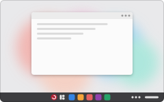
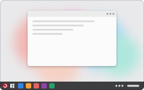

# Layout names

Status: decided by Matt on 2026-11-03, and applied on `feat/layout-modes`.

RedFox's six desktop layouts, in the order the layout picker shows them: RedFox's own first, then the two open-source desktops, then the three modelled on other systems. Those three get their own names, not the names of the systems they resemble.

| Preview | Name | What it is | `redfox-layout` id | `ujust` recipe |
| --- | --- | --- | --- | --- |
|  | **RedFox** | A floating dock on the left on big screens; the GNOME dash on small ones. | `redfox` | `preset-dock-redfox` |
|  | **GNOME** | Plain GNOME: the top bar, with the dash in the overview. | `gnome` | `preset-dock-gnome` |
|  | **Ubuntu** | A full-height dock on the left, always visible. | `ubuntu` | `preset-dock-ubuntu` |
|  | **Cal** | A floating dock along the bottom, window buttons on the left. | `cal` | `preset-dock-cal` |
|  | **Wash** | One taskbar along the bottom, with the start menu and apps centred. | `wash` | `preset-dock-wash` |
|  | **Nostalgia** | One taskbar along the bottom: start menu and apps on the left. | `nostalgia` | `preset-dock-nostalgia` |

The picker in RedFox Hub (Settings › Layout) shows them three across in that order: RedFox, GNOME and Ubuntu on top, then Cal, Wash and Nostalgia.

Each preview has a very light border round the picture (not the text), so previews with bars at the top, the bottom or the side still look the same size and in line. On hover, a card lifts slightly and gets a drop shadow.

## Files

- [`assets/layouts/make-previews.py`](../assets/layouts/make-previews.py) draws the SVG previews. It also writes `picker.html`, a mock-up of the picker to try in a browser. Rerun it after changing a layout.
- `redfox-layout list` prints the same names and descriptions, in the same order.

The old names are gone, with no aliases:
- ids: `macos`, `windows`, `windows-classic`;
- recipes: `preset-dock-macos`, `preset-dock-win-new`, `preset-dock-win-classic`.
